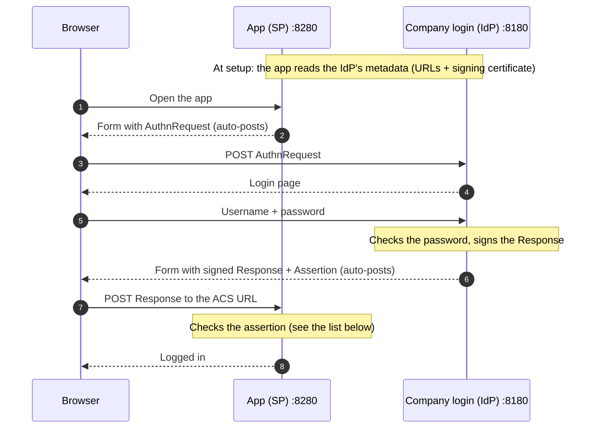

# keycloak-saml-brokering-lab

Two Keycloaks that log a user in with SAML. One is the company login (the Identity Provider). The other is the app (the Service Provider). The app trusts the company login, the same way a SaaS product lets a customer sign in with their own company account.

I built this to learn SAML hands-on. My production work has been OIDC.

Lab only: dev mode, fake users, and the passwords are in the files on purpose. The ports are open only to your own machine. Don't use this config in production.

## Run it

You need Docker.

```sh
docker compose up -d
```

Wait about 30 seconds, then open a private browser window:

1. Go to http://localhost:8280/realms/app/account
2. Click **Corp login**
3. Log in as `demouser` / `demouser123`
4. You are back in the app, logged in as Demo User

Stop it with `docker compose down`.

| | URL | Admin login |
|---|---|---|
| Company login (IdP), realm `corp` | http://localhost:8180/admin | admin / admin |
| App (SP), realm `app` | http://localhost:8280/admin | admin / admin |

## What happens



The two servers never call each other during login. Every message goes through the browser as a form that posts itself (the HTTP-POST binding). The app only calls the IdP to read its metadata, which has the IdP's URLs and signing certificate.

The AuthnRequest says who is asking (`Issuer`) and where to send the answer (`AssertionConsumerServiceURL`).

The Response holds the Assertion:

- `NameID`: who the user is (`demouser`)
- `Conditions`: valid for a short time, and only for this app (`Audience`)
- `AuthnStatement`: when the user logged in
- `AttributeStatement`: email, first name, last name

A SAML app should check these before it trusts the assertion. The lab tests the first one (`--tamper`).

- **Signature**, with the IdP's certificate from the metadata: nobody changed it
- **Issuer** is the IdP we trust
- **Audience** is this app, so an assertion made for another app can't be used here
- **Destination / Recipient** is our ACS URL
- **InResponseTo** matches our own request
- **NotBefore / NotOnOrAfter**, so an old, stolen assertion won't work

## How SAML is different from OIDC

If you know OIDC, these are the main differences:

| | SAML | OIDC |
|---|---|---|
| Proof of login | a signed XML **Assertion** | a signed JSON **ID token** (JWT) |
| How it reaches the app | the browser posts the whole assertion to the app's ACS URL | the browser only carries a short code. The app swaps it for tokens, server to server |
| How the two sides trust each other | they exchange **metadata** files (XML with URLs and certificates) | the app reads a **discovery** URL (`.well-known/openid-configuration`) and the provider's public keys (JWKS) |
| Age and use | 2005, mostly web login (SSO) in companies | 2014, web, mobile apps and APIs |

XML signatures are harder to check correctly than JWT signatures. Many SAML security bugs come from that, for example XML signature wrapping. That's why apps should use a well-tested library or product, like Keycloak here, and not write their own SAML checks.

## What the app keeps after login

After the first login, the app creates its own user `demouser` and links it to the IdP. It doesn't store a password. Every login still goes to the IdP, and the app takes the email and name from the assertion each time. If the IdP disables the user, they can't log in to the app any more.

This is different from a migration, where users and their password hashes are moved into the new system and the old one is no longer needed for login.

## See the XML yourself

```sh
python3 tools/show-saml-flow.py
```

It logs in as `demouser` like a browser would and prints the AuthnRequest and the Response. Standard library only, no installs.

To see the signature check work, change the assertion after the IdP signed it:

```sh
python3 tools/show-saml-flow.py --tamper
```

The app answers "Invalid signature in response from identity provider." You can also install the SAML-tracer browser extension and watch the messages while you click.

## Setup note

Inside Docker the app reaches the IdP's metadata at `corp-idp:8080`. The browser uses `localhost:8180`. The app reads the IdP's keys from that metadata, so there are no certificates in this repo.

Licensed under MIT.
